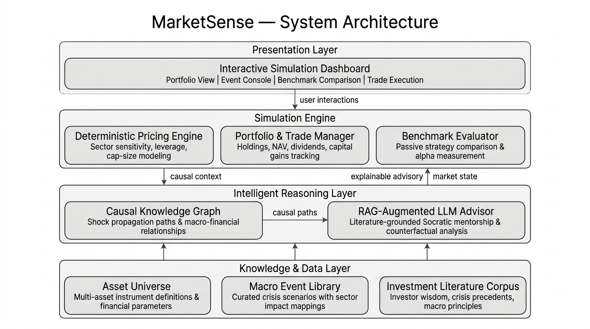

* **Group Name:** TeamChamp
* **Group Number:** 26
* **Team Member:** Gupta Swaraj (Student ID: A0357457N)
* **GitHub Project Repository:** [https://github.com/s3arajgupta/MarketSense/tree/main](https://github.com/s3arajgupta/MarketSense/tree/main)
* **[ Naming Convention ]** CourseCode-StartDate-BatchCode-TeamName-ProjectName.zip
* **[ Project Submission Zip Naming ]** `IRS-PM-2026-10-25-GRP26-TeamChamp-MarketSense.zip`
> 🚀 **Interact with Live Application within seconds:** [https://marketsense-ai-nus.streamlit.app/](https://marketsense-ai-nus.streamlit.app/)
[](https://marketsense-ai-nus.streamlit.app/)  

---

## SECTION 1 : PROJECT TITLE

## MarketSense AI: A Neuro-Symbolic Intelligent Reasoning Simulator for Macroeconomic Shocks & Portfolio Adaptability

### [ 1 ] Interactive Portfolio Flight Simulator & Institutional Benchmarks


### [ 2 ] Explainable AI (XAI) Macroeconomic Causal Knowledge Graph & Socratic AI Mentor


### [ 3 ] End-to-End Neuro-Symbolic System Architecture



---

## SECTION 2 : EXECUTIVE SUMMARY / PAPER ABSTRACT

Over 80% of retail investors suffer severe, unrecoverable capital drawdowns during macroeconomic crises—such as sudden central bank tightening cycles, inflationary supply shocks, pandemic demand freezes, and banking panics. This failure stems from behavioral panic, absence of safe crisis training, and modern trading apps that gamify hyper-trading, leading to destructive fee churning and tax drag.

Existing solutions fail to bridge this knowledge gap: paper-trading platforms act as passive price mirrors with zero causal explanation; commercial robo-advisors operate as opaque black boxes; and university finance curricula remain heavily theoretical without hands-on crisis flight simulation.

**MarketSense AI** resolves this crisis as an institutional-grade **Portfolio Flight Simulator** powered by a hybrid **neuro-symbolic intelligent reasoning architecture**. Trainees manage a virtual S$100,000 multi-asset portfolio across 24 granular instruments (equities spanning 6 sectors and 3 market caps, sovereign bonds, gold, cash, and crypto), navigate 22 curated macroeconomic crisis scenarios across a 30-year (120-quarter) horizon, and receive explainable, literature-grounded Socratic guidance.

MarketSense is governed by an uncompromisable design invariant: **Mathematics handles numbers; AI handles explanation. The LLM never computes asset prices.**

The system tightly integrates:

1. **Deterministic Financial Core:** Closed-form formulaic pricing incorporating sector beta, debt ratios ($> 0.40$ penalty threshold), and cash resilience buffers; realistic friction mechanics enforcing Short-Term Capital Gains (STCG @ 25%) vs Long-Term Capital Gains (LTCG @ 10%) plus 0.15% brokerage fees; and automated circuit breakers freezing sales during sudden Black Swan events.
2. **Symbolic Macroeconomic Causal Knowledge Graph:** A 36-node, 48-edge directed multigraph implemented in NetworkX, featuring resistance-weighted shortest transmission path extraction and cumulative sign polarity tracking ($+ \times + \times + \times - = -$), rendered through an interactive force-directed physics canvas (`Pyvis` / `Vis.js`).
3. **Cognitive Grounded RAG v2 & Socratic AI Mentor:** A persistent ChromaDB vector store (52 chunks, `all-MiniLM-L6-v2`) indexing seminal wisdom from Graham, Dalio, Marks, Lynch, Bogle, and Taleb, paired with 22 empirical historical crisis twin precedents. A dual-runtime Socratic AI Mentor (Cloud Google Gemini 2.5 Flash or 100% offline air-gapped Ollama) delivers grounded causal shock debriefs and multi-decade career retrospectives without financial hallucinations.
4. **Counterfactual "What-If" Sandbox & Benchmarking:** Real-time counterfactual simulation evaluating user alpha and asset-by-asset drawdowns against four institutional strategies (Ray Dalio All-Weather, Pure Cash, Gold Defense, Tech Aggressive) and a cumulative CPI purchasing power hurdle derived via the Fisher equation.

MarketSense AI bridges theoretical macroeconomic reasoning and practical portfolio risk management, cultivating capital preservation discipline and causal literacy before investors risk real-world capital.

---

## SECTION 3 : CREDITS / PROJECT CONTRIBUTION

| Official Full Name | Student ID (MTech Applicable) | Group & Team | Work Items (Who Did What) | Email (Optional) |
| :------------ | :---------------: | :-----: | :----- | :----- |
| **Gupta Swaraj** | **A0357457N** | **TeamChamp (Group 26)** | • End-to-end neuro-symbolic architecture design and implementation.<br>• Deterministic pricing engine, capital preservation bounds, and portfolio accounting (`engine/`).<br>• Real-world financial friction engine (STCG vs LTCG tax drag, brokerage costs, circuit breaker rules).<br>• NetworkX macroeconomic causal knowledge graph (36 nodes, 48 edges) and Dijkstra shortest transmission path extraction.<br>• Interactive Pyvis physics-based graph visualizer and Streamlit XAI integration.<br>• RAG v2 knowledge base ingestion in ChromaDB (52 chunks across 6 masters & 22 crisis twins).<br>• Dual-runtime AI Mentor orchestrator (Google Gemini 2.5 Flash + offline air-gapped Ollama).<br>• Counterfactual "What-If" sandbox and passive institutional benchmark tracking (All-Weather, 60/40, Equity, CPI Hurdle).<br>• Automated verification test suite (25/25 unit tests passing in pytest).<br>• Comprehensive academic documentation and modular course mappings. | <A0357457N@u.nus.edu> |

---

## SECTION 4 : VIDEO OF SYSTEM MODELLING & USE CASE DEMO

### [ 1 ] Promotional Pitch & Use Case Demo (5 Minutes)

[](https://youtu.be/Oq-QEI3UvJw "IRS PM 2026 10 25 GRP26 TeamChamp MarketSense Promotion")

* **Video Title:** `IRS PM 2026 10 25 GRP26 TeamChamp MarketSense Promotion`
* **YouTube Video Link:** [https://youtu.be/Oq-QEI3UvJw](https://youtu.be/Oq-QEI3UvJw)
* **Coverage:** Business Pain & Retail Investor Crisis; MarketSense Solution & Novelty; Live Interactive Use Case Demo (24 Assets, Rate Hike Shock, Circuit Breakers, Causal XAI Graph, Counterfactual Sandbox); Business Model & 3-Tier Pricing Strategy.

### [ 2 ] High-Level System Design & Course Mapping (5 Minutes)

[](https://youtu.be/l_06wWVMz8U "IRS PM 2026 10 25 GRP26 TeamChamp MarketSense System")

* **Video Title:** `IRS PM 2026 10 25 GRP26 TeamChamp MarketSense System`
* **YouTube Video Link:** [https://youtu.be/l_06wWVMz8U](https://youtu.be/l_06wWVMz8U)
* **Coverage:** Tripartite Deliberative/Reactive Neuro-Symbolic Architecture; Deterministic Pricing & CSP Constraints (MR); NetworkX Causal Graph & Dijkstra Polarity Propagation (MR & CGS); Grounded RAG v2 & Dual Runtime Socratic Mentor (RS & CGS); Automated Verification & Benchmarks.

*Note: In strict compliance with assessment rules, all presentation speech is delivered by human voice (no AI-synthesized voices).*

---

## SECTION 5 : USER GUIDE

`Refer to appendix <Installation & User Guide> in project report at: documentations/appendix_installation_user_guide.md`

### [ 1 ] Prerequisites

* Python 3.10+ (tested on Python 3.10, 3.11, 3.12, 3.14).

* Modern web browser (Chrome, Edge, Brave, Firefox) with WebGL enabled for Pyvis network physics.

### [ 2 ] Quickstart Installation & Execution

#### Step 1: Clone Repository & Create Virtual Environment

```bash
git clone https://github.com/s3arajgupta/MarketSense.git
cd MarketSense

# Windows PowerShell:
python -m venv .venv
.\.venv\Scripts\Activate.ps1

# macOS / Linux:
python3 -m venv .venv
source .venv/bin/activate
```

#### Step 2: Install Dependencies

```bash
pip install -r requirements.txt
```

#### Step 3: Configure LLM Runtime (Dual Provider Support)

**Option A: Cloud Google Gemini API (Recommended — Zero Model Download)**

```bash
cp .env.example .env
# Edit .env and insert your free Gemini API key from https://aistudio.google.com/apikey
# GEMINI_API_KEY="your-api-key"
# LLM_PROVIDER="gemini"
```

**Option B: 100% Offline Air-Gapped Local Inference (Ollama)**

```bash
# 1. Install Ollama from https://ollama.ai
# 2. Pull model:
ollama pull llama3.1:8b
# 3. Configure .env:
# LLM_PROVIDER="ollama"
# OLLAMA_MODEL="llama3.1:8b"
```

*(Note: MarketSense features graceful degradation; the simulator, pricing, knowledge graphs, and benchmarks operate with full fidelity even if no LLM is configured).*

#### Step 4: Run Application

**Option A: Instant Live Web Application (Zero Setup)**

* Access directly on Streamlit Community Cloud: [https://marketsense-ai-nus.streamlit.app/](https://marketsense-ai-nus.streamlit.app/)

**Option B: Run Locally**

```bash
streamlit run app.py
```

Open your browser to `http://localhost:8501`.

#### Step 5: Run Automated Test Suite

```bash
pytest
```

*Expected Result: 25 passed in ~4.08s (100% passing).*

---

## SECTION 6 : PROJECT REPORT / PAPER

`Refer to project documentation and formal appendices located in: documentations/`

**Project Report Sections & Appendices:**

1. **Executive Summary & Abstract:** [`documentations/appendix_project_proposal.md`](documentations/appendix_project_proposal.md)
2. **Business Problem & Retail Investor Crisis:** [`documentations/salient_features.md`](documentations/salient_features.md)
3. **System Architecture & Neuro-Symbolic Design:** [`documentations/README.md`](documentations/README.md), [`documentations/architecture.jpg`](documentations/architecture.jpg)
4. **Causal Knowledge Graph & Path Extraction (XAI):** [`documentations/salient_features.md#11`](documentations/salient_features.md)
5. **System Verification & Pytest Results:** [`reports_by_gemini/Phase3.md`](reports_by_gemini/Phase3.md)
6. **Technique Group Compliance Assessment:** [`documentations/compliance.md`](documentations/compliance.md)
7. **Appendix A: Project Proposal Baseline:** [`documentations/appendix_project_proposal.md`](documentations/appendix_project_proposal.md)
8. **Appendix B: Mapped System Functionalities against Modular Courses (MR, RS, CGS):** [`documentations/appendix_course_mapping.md`](documentations/appendix_course_mapping.md)
9. **Appendix C: Installation and User Guide:** [`documentations/appendix_installation_user_guide.md`](documentations/appendix_installation_user_guide.md)

---

## SECTION 7 : MISCELLANEOUS

`Refer to repository data, knowledge corpora, and test assets:`

### [ 1 ] Curated Macroeconomic Knowledge Corpus (`data/knowledge/`)

* `causal_graph.json`: 36 economic nodes (Drivers, Channels, Sectors, Assets) and 48 directed weighted edges with resistance metrics and polarity mappings for all 22 crisis scenarios.

* `crisis_precedents.json`: 22 empirical historical crisis twin case studies with quantitative comparative metrics (1980 Volcker, 1973 OPEC, 1931 Creditanstalt, 1918 Flu, 2000 Dot-Com).
* `dalio.json`, `graham.json`, `marks.json`, `lynch.json`, `bogle.json`: 30 concept-chunked investor axioms covering debt cycles, margin of safety, second-level thinking, and indexing.
* `crisis_cases.json`: 7 landmark historical crisis post-mortems (1973–2022).

### [ 2 ] Financial Data Assets (`data/`)

* `assets.json`: 24 institutional instruments with explicit Beta, Debt Ratio, Cash Resilience, and Dividend Yield attributes.

* `crisis_cards.json`: 22 curated macroeconomic crisis cards with annualized inflation rates and sector impact vectors.

### [ 3 ] Verification & Phase Audit Reports

* `reports_by_gemini/Phase2.md`: Phase 2 LLM mentor, friction engine, and flight controls verification.

* `reports_by_gemini/Phase3.md`: Phase 3 Knowledge graph, Pyvis visualizer, and What-If sandbox verification.
* `reports_by_opus/Phase1.md`: Phase 1 MVP simulation engine verification.

---

### Project Submission Summary

* **Project Title:** MarketSense AI: A Neuro-Symbolic Intelligent Reasoning Simulator for Macroeconomic Shocks & Portfolio Adaptability
* **Team Name:** TeamChamp
* **Group Number:** Group 26
* **Student:** Gupta Swaraj (Student ID: A0357457N)
* **GitHub Project Repository:** [https://github.com/s3arajgupta/MarketSense/tree/main](https://github.com/s3arajgupta/MarketSense/tree/main)
* **Live Web Application (Streamlit Cloud):** [https://marketsense-ai-nus.streamlit.app/](https://marketsense-ai-nus.streamlit.app/)
* **Project Submission Archive:** `IRS-PM-2026-10-25-GRP26-TeamChamp-MarketSense.zip`

---

**These courses are part of the Graduate Certificate in [Intelligent Reasoning Systems (IRS)](https://www.iss.nus.edu.sg/stackable-certificate-programmes/intelligent-systems "Intelligent Reasoning Systems") series offered by [NUS-ISS](https://www.iss.nus.edu.sg "Institute of Systems Science, National University of Singapore").**
